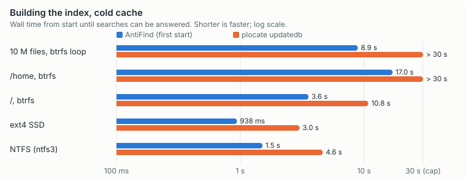
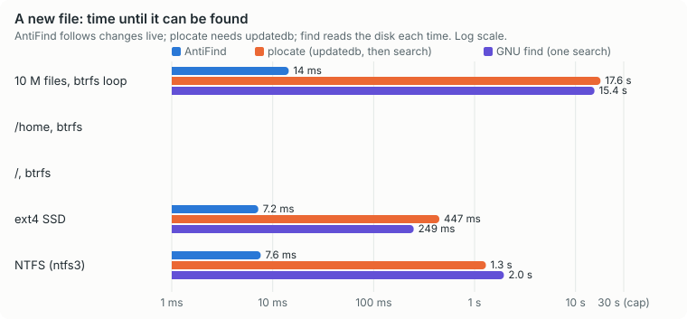
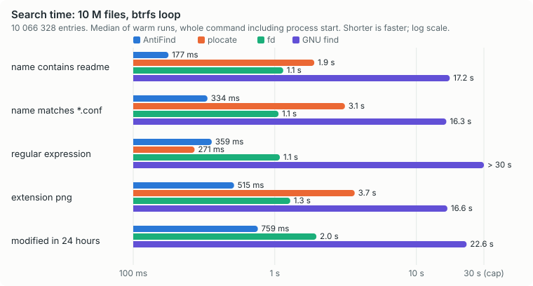
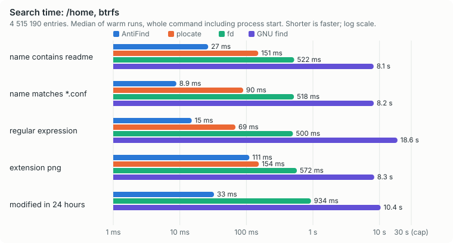
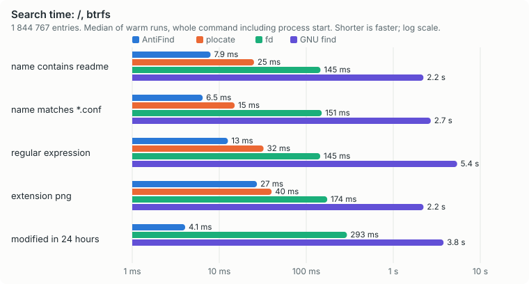
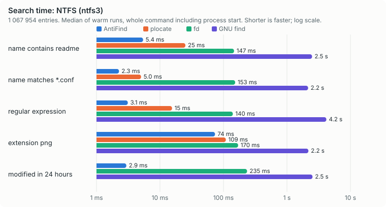
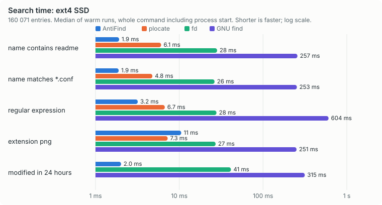

# Benchmarks

AntiFind against the tools people use today to find files by name. The numbers here are
measured with the same scripts at every release; the raw results are kept with the source.

## In short

Searching for a name that contains `readme`, warm cache, the median of 30 runs, every match
printed (the run of 2026-10-18):

| data set | entries | AntiFind | plocate | fd | GNU find |
|---|---|---|---|---|---|
| 10 M synthetic files, btrfs | 10 066 328 | 177 ms | 1.90 s | 1.15 s | 17.2 s |
| /home, btrfs | 4 515 190 | 27 ms | 151 ms | 522 ms | 8.15 s |
| / (root), btrfs | 1 844 767 | 7.9 ms | 25 ms | 145 ms | 2.22 s |
| NTFS volume | 1 067 954 | 5.4 ms | 25 ms | 147 ms | 2.48 s |
| ext4 SSD | 160 071 | 1.8 ms | 5.7 ms | 26 ms | 255 ms |

A new file can be found by AntiFind 8 to 14 ms after it is made; plocate finds it only after
its next `updatedb` (17.6 s for the 10 M files). All tools found the same files (see the synthetic tree below, per
query). Where another tool is better, it says so under "Where others win".

## Method

* **Machine:** AMD Ryzen 9 3950X (16 cores, 32 threads), 128 GB RAM, NVMe, Linux 7.2. The
  machine was also used for other work while the tests ran; where numbers vary it shows in the
  95th and 99th percentile columns.
* **What is timed:** the wall time of the whole command from start to exit, measured
  from fork to exit, so every tool pays for starting its process. AntiFind's
  figure includes connecting to the already running service.
* **Output:** results are written to `/dev/null`. Every tool prints every match, unsorted
  (AntiFind with `-n 0 --sort none`).
* **One filesystem:** every tool stays on the data set's own filesystem (`find -xdev`,
  `fd --one-file-system`, `updatedb --prunepaths` for the mounts below it), as AntiFind does.
* **Queries and result sets:** the same questions are asked of every tool and the results are
  compared with GNU `find` (`-iname`, `-iregex`, `-mmin`): the same paths, or the differences
  are counted and explained below. plocate is asked to match the base name only (`-b`).
* **Cold cache:** `echo 3 > /proc/sys/vm/drop_caches` before each run. AntiFind answers from
  memory, so for it a cold run only shows the process start; its index build and restart
  numbers are where the disk matters.
* **Warm runs:** 30 runs per query, or 5 when a single run takes more than 2 seconds.
* **A 30 second cap:** a run still going after 30 seconds is stopped and shown as "> 30 s";
  the charts end at 30 s. That tool is not run again for that query.
* **What is left out:** each data set lists the mounts below it (other disks, network and FUSE
  mounts such as rclone, tmpfs). No tool reads them, and no data set is on a network or FUSE
  mount.
* **plocate's settings:** `updatedb` is run with `--prune-bind-mounts=no --prunenames=` and the
  mounts below the data set as `--prunepaths`, so it indexes what the other tools see: by
  default `/etc/updatedb.conf` leaves out `.git` folders and treats btrfs subvolume mounts such
  as `/home` as bind mounts. The /home set was measured with these settings; on the other sets
  the defaults changed nothing in what plocate found (the same matches as `find`).
* **Not compared:** FSearch (a graphical program with no command line, so it cannot be timed
  the same way) and `mlocate` (`plocate` is its successor and conflicts with it on this system).
  `rg --files` only lists files and cannot filter by name or time itself, so it is left out of
  the tables; `fd` is the fair "no index" competitor.

## Where others win

* A tool that does not keep an index (`find`, `fd`) uses no memory between searches and starts
  without a service. AntiFind needs a running service and holds the names in memory.
* plocate's database is smaller than AntiFind's index (34 MB against 146 MB for /), and its
  search time is excellent. It was faster than AntiFind in two of the 25 measurements: the
  regular expression on the synthetic tree (271 ms against 359 ms; plocate filters its
  trigram index first) and extension `png` on the ext4 disk (7.7 ms against 9.6 ms). In
  both, AntiFind spends most of the time sending and printing hundreds of thousands of paths.
* AntiFind's first index takes more memory while it is built (2.1 GB at the peak for the 10
  million files) than plocate's `updatedb` (245 MB); afterwards the service holds 705 MB.
* `find` can act on what it finds (`-exec`, `-delete`) and compare with another file
  (`-newer`); with AntiFind you pipe the paths to another program (`antifind -0 ... | xargs -0`).

_Measured on 2026-10-18. Versions: find 4.11.0-modified, fd 10.5.0, plocate 1.1.25, ripgrep 15.2.0, du 9.12, ncdu 2.9.2, gdu 5.38.0, AntiFind 0.1.0._

## Synthetic tree, btrfs loop volume

10066328 entries (files and directories). AntiFind read them with its btrfs reader.
Nothing is mounted below it.

### Building the index

| tool | wall time | CPU time | peak memory |
|---|---|---|---|
| AntiFind, first start (cold cache) | 8.9 s | 39.2 s | 2116 MB |
| plocate `updatedb`, cold cache | > 30 s | |  |
| plocate `updatedb`, warm cache | 24.8 s | 24.7 s | 245 MB |

AntiFind index file on disk: 561 MB; plocate database: 198 MB. AntiFind service resident memory: 705 MB. Start from the saved index: 6.86 s.

### Query time

Median, 95th and 99th percentile of wall time per run, including starting the program, over warm-cache runs; and the median of cold-cache runs (caches dropped before each run).

| query | tool | warm median | warm p95 | warm p99 | cold median | results |
|---|---|---|---|---|---|---|
| name contains `readme` | AntiFind | 177 ms | 193 ms | 209 ms | 182 ms | 167232 |
| name contains `readme` | plocate | 1.90 s | 1.98 s | 2.01 s | 1.89 s | 167232 |
| name contains `readme` | fd | 1.15 s | 1.20 s | 1.20 s | 6.44 s | 167232 |
| name contains `readme` | GNU find | 17.21 s | 17.33 s | 17.33 s | > 30 s | 167232 |
| name matches `*.conf` | AntiFind | 334 ms | 352 ms | 356 ms | 347 ms | 446911 |
| name matches `*.conf` | plocate | 3.13 s | 3.21 s | 3.21 s | 3.08 s | 446911 |
| name matches `*.conf` | fd | 1.06 s | 1.21 s | 1.21 s | 4.84 s | 446911 |
| name matches `*.conf` | GNU find | 16.28 s | 16.51 s | 16.51 s | > 30 s | 446911 |
| name matches `^lib.*\.so\.[0-9]+$` | AntiFind | 359 ms | 377 ms | 386 ms | 370 ms | 447031 |
| name matches `^lib.*\.so\.[0-9]+$` | plocate | 271 ms | 300 ms | 301 ms | 296 ms | 447031 |
| name matches `^lib.*\.so\.[0-9]+$` | fd | 1.09 s | 1.16 s | 1.19 s | 4.83 s | 447031 |
| name matches `^lib.*\.so\.[0-9]+$` | GNU find | > 30 s | > 30 s | > 30 s | > 30 s | 447031 |
| extension `png` | AntiFind | 515 ms | 570 ms | 631 ms | 507 ms | 894239 |
| extension `png` | plocate | 3.67 s | 3.71 s | 3.71 s | 4.66 s | 894239 |
| extension `png` | fd | 1.29 s | 1.88 s | 1.91 s | 4.96 s | 894239 |
| extension `png` | GNU find | 16.56 s | 16.57 s | 16.57 s | > 30 s | 894239 |
| modified in the last 24 hours | AntiFind | 759 ms | 850 ms | 879 ms | 759 ms | 1308003 |
| modified in the last 24 hours | fd | 1.97 s | 2.10 s | 2.11 s | 11.73 s | 1308003 |
| modified in the last 24 hours | GNU find | 22.63 s | 23.09 s | 23.09 s | > 30 s | 1308003 |

### Same results as `find`?

| query | tool | find found | both | only find | only the tool |
|---|---|---|---|---|---|
| name contains `readme` | AntiFind | 167232 | 167232 | 0 | 0 |
| name contains `readme` | plocate | 167232 | 167232 | 0 | 0 |
| name contains `readme` | fd | 167232 | 167232 | 0 | 0 |
| name matches `*.conf` | AntiFind | 446911 | 446911 | 0 | 0 |
| name matches `*.conf` | plocate | 446911 | 446911 | 0 | 0 |
| name matches `*.conf` | fd | 446911 | 446911 | 0 | 0 |
| regular expression | AntiFind | 447031 | 447031 | 0 | 0 |
| regular expression | plocate | 447031 | 447031 | 0 | 0 |
| regular expression | fd | 447031 | 447031 | 0 | 0 |
| extension `png` | AntiFind | 894239 | 894239 | 0 | 0 |
| extension `png` | plocate | 894239 | 894239 | 0 | 0 |
| extension `png` | fd | 894239 | 894239 | 0 | 0 |
| modified in 24 hours | AntiFind | 1308003 | 1307999 | 4 | 0 |
| modified in 24 hours | fd | 1308003 | 1307994 | 9 | 0 |

### Freshness

Create a file, then wait until the tool can find it. AntiFind: 14 ms. plocate: only after `updatedb`, which took 17.65 s for this data set. find and fd: they read the disk each time, so the time is one search, 15.39 s for find.

## More data sets

The same measurements for /home and / on btrfs, an NTFS volume and an ext4 SSD (search times in the charts below) follow the same method; they are summed up in the table at the top.

